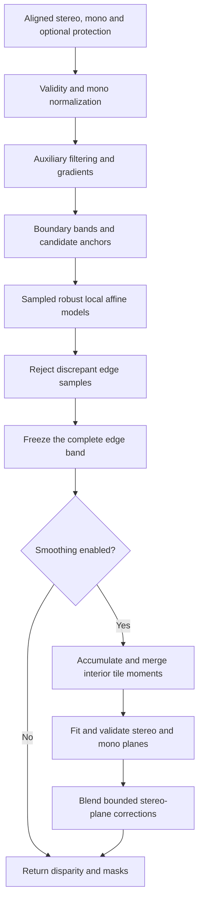

# Mathematical specification of the C++ edge-first refiner

This document specifies the current native **`edge_mode=1`, ABI 2** implementation. It describes the existing algorithm, including its numerical guards and approximations. The retained V1/V2 algorithms and legacy native `edge_mode=0` are separate methods; see [their comparison](cpp_vs_v1_v2.md).

Optional `edge_mode=2` adds a discrete mono-neighbor match and directional-consensus veto after the mode-1 candidate in Section 6. Its complete additional equations and tradeoffs are specified in [the edge-rejection guard](edge_rejection_guard.md). The remaining filtering, model fits, edge-band freezing and plane stage are shared. Mode 1 remains the default.

The processing order is **edge rejection first, complete edge-band protection second, interior plane smoothing last**. Mono supplies structural guidance and local rejection evidence. Stereo supplies the metric disparity values used for smoothing. There is no learned component, object classifier, hole completion or temporal state inside this kernel.

Equations below describe real-arithmetic operations corresponding to the float32 implementation. Section 12 states the floating-point qualifications. Indices are zero-based; image coordinates are measured in image pixels, and stereo disparity is measured in disparity pixels. These units must not be conflated.

## 1. Scope, inputs and notation

Let the processing domain be

$$
\Omega=\{0,\ldots,W-1\}\times\{0,\ldots,H-1\},\qquad W=640,\ H=360
$$

for the active resized target, corrected on 2026-11-04 to preserve the source aspect ratio. The sample evaluation also runs original 1280×720 inputs. The API and all equations are parameterized by $W,H$; historical numerical audits at 640×400 remain preserved. Stereo and mono are contiguous row-major float32 arrays on the **same pixel grid**; optional protection is a same-sized uint8 mask:

| Symbol | Meaning |
|---|---|
| $s(p)$ | Original stereo disparity |
| $m(p)$ | Mono prediction with larger values meaning nearer geometry |
| $P(p)$ | Optional explicit protection mask; nonzero means protected |
| $V_s(p)$ | $\operatorname{finite}(s(p))\land[s(p)>0.05]$ |
| $V_m(p)$ | $\operatorname{finite}(m(p))$ |
| $g(p)$ | Normalized, unfiltered mono guidance |
| $R(p)$ | Rejection mask |
| $o(p)$ | Final output disparity |

The mathematical use of mono assumes an inverse-depth-like ordering. If the supplied prediction is metric depth, its conversion to suitable guidance belongs outside this kernel. Finite zero and negative mono values are allowed; finite nonpositive stereo values are invalid.

The caller is responsible for registration, visibility handling, disparity decoding and any conversion to float32. Inference, camera projection and image resizing are outside the native algorithm. Inputs and outputs must satisfy the C API's non-overlap contract; each concurrent stream needs its own context.

## 2. Initialization and mono normalization

Initially copy the stereo input to the output, including the bit patterns of invalid samples, and clear both output masks:

$$
o\leftarrow s,\qquad R\leftarrow0,\qquad M_{\mathrm{smooth}}\leftarrow0.
$$

Over **all finite mono samples**, including those with invalid stereo or explicit protection, compute

$$
m_{\min}=\min_{V_m(p)}m(p),\qquad m_{\max}=\max_{V_m(p)}m(p).
$$

If no finite mono exists, return the initialized output. Also return it if the float32 subtraction $m_{\max}-m_{\min}$ is nonfinite. Otherwise set

$$
L=\max(m_{\max}-m_{\min},10^{-6}),\qquad
g(p)=\begin{cases}(m(p)-m_{\min})/L,&V_m(p),\\0,&\neg V_m(p).\end{cases}
$$

The zero at an invalid mono sample is an internal placeholder; $V_m$ remains false. Unlike reference percentile normalization, there is no percentile clipping. Extreme finite mono values can therefore compress the useful normalized range.

A finite constant mono field is **not** an early-return condition. It produces $g=0$, fails the edge-model span gate, but can still pass the later mono-plane test. Constant mono is not a confidence certificate.

## 3. Auxiliary filtering and boundary detection

All filters in this section use replicated image borders. Define

$$
\pi(x,y)=\bigl(\operatorname{clip}(x,0,W-1),\operatorname{clip}(y,0,H-1)\bigr).
$$

These auxiliary filtered fields select boundaries and anchors. The affine rejection fits and stereo plane fits use **unfiltered** $g$ and $s$.

### 3.1 Validity-weighted binomial filtering of mono

For offsets $u\in\{-2,-1,0,1,2\}$, use

$$
h=\frac1{16}[1,4,6,4,1],\qquad K(u,v)=h(u)h(v).
$$

This separable kernel has unit mass, zero first moment and variance one image-pixel squared per axis. It is a discrete Gaussian-like approximation, not an exact sampled Gaussian. Define

$$
D_m(p)=\sum_{u,v=-2}^{2}K(u,v)V_m\bigl(\pi(p+(u,v))\bigr),
$$

$$
\widetilde g(p)=\begin{cases}
\displaystyle\frac{\sum_{u,v=-2}^{2}K(u,v)g\bigl(\pi(p+(u,v))\bigr)}{D_m(p)},&D_m(p)>0,\\[6pt]
0,&D_m(p)=0.
\end{cases}
$$

Because $g=0$ where mono is invalid, the numerator excludes missing samples. The implementation filters numerator and validity weights separately, then divides. With $N_m$ denoting the numerator above, its stored scaling computes $16N_m/\max(10^{-6},16D_m)$. The smallest positive $D_m$ is $1/256$, so the denominator floor only changes the empty-support case.

Validity weighting avoids averaging missing samples as actual zero-valued guidance. It does not guarantee an absence of hole-induced boundaries: a completely unsupported filtered location falls back to zero and can differ from supported neighbors.

### 3.2 Locally filled, separable median-5 filtering of stereo

For each pixel $p$, define a fallback value $f(p)$ by selecting the **first stereo-valid** sample in this priority order, with each position clamped by $\pi$:

$$
p,\quad p-(1,0),\quad p+(1,0),\quad p-(0,1),\quad p+(0,1).
$$

If none is valid, use $f(p)=0$. This is equivalent to the implementation's last-valid overwrite order: down, up, right, left, center. It is local fallback selection, not a nearest-valid distance transform.

For the horizontal filter centered at $p$, define

$$
t_p(u)=\begin{cases}s\bigl(\pi(p+(u,0))\bigr),&V_s\bigl(\pi(p+(u,0))\bigr),\\f(p),&\text{otherwise},\end{cases}
$$

$$
q_s(p)=\operatorname{median}_{u=-2}^{2}t_p(u),\qquad
\widetilde s(p)=\operatorname{median}_{v=-2}^{2}q_s\bigl(\pi(p+(0,v))\bigr).
$$

All invalid taps in one horizontal window use its center's fallback $f(p)$. The vertical filter acts on the already finite horizontal field. Horizontal-then-vertical median filtering is not generally equal to a full 5×5 median. It suppresses isolated extremes but may remove thin structures or alter corners. It never fills output stereo.

### 3.3 Discrete derivatives

For any auxiliary field $f$, let $x_-=\max(0,x-1)$, $x_+=\min(W-1,x+1)$, and define $y_-,y_+$ analogously. Then

$$
D_xf(x,y)=\frac{f(x_+,y)-f(x_-,y)}{x_+-x_-},\qquad
D_yf(x,y)=\frac{f(x,y_+)-f(x,y_-)}{y_+-y_-}.
$$

This is a central difference inside the image and a one-sided difference at its borders. Define

$$
B_m(p)=\left[(D_x\widetilde g)^2+(D_y\widetilde g)^2>\tau_g^2\right],
$$

$$
B_s(p)=\left[(D_x\widetilde s)^2+(D_y\widetilde s)^2>\tau_s^2\right],\qquad B=B_m\lor B_s.
$$

The code compares squared magnitudes, avoiding square roots. Defaults are $\tau_g=0.012$ normalized mono units per image pixel and $\tau_s=2$ disparity pixels per image pixel. The field name `stereo_jump_px` denotes this filtered-gradient threshold in mode 1, not a raw adjacent-disparity jump.

Boundary indicators are evaluated throughout the auxiliary fields; they are not individually masked by original validity. Later anchor, rejection and smoothing rules impose validity.

## 4. Boundary bands and anchor selection

Define square dilation, clipped to the image, by

$$
(\mathcal D_r A)(p)=\bigvee_{q\in\Omega:\|q-p\|_\infty\leq r}A(q).
$$

The anchor guard and rejection band are

$$
G=\mathcal D_{r_a}(B\lor P),\qquad E=\mathcal D_{r_e}(B),
$$

with default $r_a=3$, $r_e=6$. Explicit protection enters $G$ but does not by itself generate a rejection band.

The median-consistency candidate mask and accepted anchor mask are

$$
C(p)=V_s(p)\land V_m(p)\land[|s(p)-\widetilde s(p)|\leq\tau_a],
$$

$$
A(p)=C(p)\land\neg G(p),\qquad \tau_a=0.75\ \text{disparity pixels}.
$$

Median consistency is a confidence heuristic. A spatially coherent stereo error can satisfy it. Edge-model anchors exclude $G$, not the entire rejection band $E$; the stronger plane guard is introduced only after rejection. Protection freezes output samples and guards local support; it does not remove their values from normalization or auxiliary filtering.

## 5. Local mono-to-stereo models

### 5.1 Independent edge grid and clipped windows

Let edge stride $S=16$, window width $L_e=49$ and radius $r=(L_e-1)/2=24$. Edge model centers are

$$
c_{k\ell}=(kS,\ell S),\qquad
0\leq k<\lceil W/S\rceil,\quad0\leq\ell<\lceil H/S\rceil.
$$

Each model uses $\mathcal W_{k\ell}=\{p\in\Omega:|p_x-kS|\leq r,\ |p_y-\ell S|\leq r\}$. Clipping shortens border windows; it does not introduce padded training samples.

The edge grid is independent of the later plane grid. Although both default spacings are 16, their centers differ, and changing plane tile size does not move the edge grid.

Before fitting, the implementation flags stride-sized blocks containing any eligible edge pixel $V_sV_mE\neg P$, then builds a 2D summed-area table of those block flags. A window is skipped if all blocks intersecting its clipped rectangle are empty. This coarse occupancy query can attempt extra empty windows, but cannot skip a window containing an eligible edge pixel. It is a work-saving test, not a confidence test.

### 5.2 Deterministic sample lattice

Let the configured sample budget be $B_e$ and $q=\lfloor\sqrt{B_e}\rfloor$. For one clipped coordinate interval $[a,b)$, set $n_x=\min(q,b-a)$ and sample

$$
x_j=\begin{cases}a,&n_x=1,\\a+\left\lfloor\dfrac{j(b-a-1)}{n_x-1}\right\rfloor,&n_x>1,\end{cases}\qquad j=0,\ldots,n_x-1.
$$

Construct the vertical axis identically and form their Cartesian product. Retain only lattice locations satisfying $A$. Scan them in increasing row, then column order. The default $B_e=64$ gives at most 8×8 locations; it does not guarantee 64 surviving anchors. Non-square budgets use only $q^2$ lattice locations.

A model requires at least $n_{e,\min}=12$ sampled anchors. There is no edge-model 70% area-coverage requirement. That requirement belongs to plane fitting.

### 5.3 Quantile convention and mono span gate

For sorted values $z_{(0)}\leq\cdots\leq z_{(n-1)}$, define a linearly interpolated quantile by

$$
u=(n-1)t,\quad j=\lfloor u\rfloor,\quad\theta=u-j,\quad
Q_t(z)=(1-\theta)z_{(j)}+\theta z_{(\min(j+1,n-1))}.
$$

This convention defines every percentile and median used by the edge model. The implementation uses bounded work arrays and selection rather than sorting the entire array.

For sampled pairs $(g_j,s_j)$, require

$$
Q_{0.95}(g)-Q_{0.05}(g)\geq\Delta_g,\qquad\Delta_g=0.025.
$$

This prevents fitting a scale from nearly constant mono, but does not establish that mono and stereo describe the same surface.

### 5.4 Centered weighted affine solve

Use the first sampled anchor as reference: $g_0,s_0$. Define $u_j=g_j-g_0$, $v_j=s_j-s_0$ and initialize $w_j^{(0)}=1$. At each fit, solve

$$
\min_{a,\gamma}\sum_jw_j\bigl(v_j-au_j-\gamma\bigr)^2.
$$

Accumulate

$$
S_w=\sum_jw_j,\quad S_u=\sum_jw_ju_j,\quad S_v=\sum_jw_jv_j,\quad
S_{uu}=\sum_jw_ju_j^2,\quad S_{uv}=\sum_jw_ju_jv_j.
$$

Let $D=S_{uu}-S_u^2/S_w$. Abort the model unless $D>10^{-10}S_w$ and $D$ is finite. Otherwise,

$$
a=\frac{S_{uv}-S_uS_v/S_w}{D},\qquad
\gamma=\frac{S_v-aS_u}{S_w}.
$$

Both $a$ and $\gamma$ must be finite. Centering reduces cancellation from a large absolute disparity offset; it does not remove float32 conditioning limits.

### 5.5 Fixed-budget Huber reweighting

Compute residuals

$$
r_j=v_j-(au_j+\gamma).
$$

Between fits, estimate scale and update weights:

$$
\mu_r=Q_{0.5}(r),\qquad
\sigma=\max\!\left(\sigma_{\min},1.4826\,Q_{0.5}(|r-\mu_r|)\right),\qquad\sigma_{\min}=0.15\ \text{px},
$$

$$
w_j\leftarrow\min\!\left(1,\frac{1.5\sigma}{\max(|r_j|,10^{-8}\ \text{px})}\right).
$$

The MAD is centered by $\mu_r$; the weight denominator uses the **uncentered residual magnitude** $|r_j|$. The factor $1.4826\simeq1/\Phi^{-1}(0.75)$, where $\Phi$ is the standard normal cumulative distribution function, gives Gaussian population-scale consistency for MAD; it is not a guarantee that residuals are Gaussian.

Default `edge_iterations=3` means three weighted solves and two intervening weight updates. The algorithm does not iterate to convergence. It should not be described as the exact minimizer of a converged robust objective.

After the final fit, require

$$
a>0,\qquad Q_{0.8}(|r|)\leq\tau_{\mathrm{fit}},\qquad\tau_{\mathrm{fit}}=2\ \text{px}.
$$

The quantile gate is unweighted and uses the same sampled training anchors, not held-out data. Store

$$
b=s_0+\gamma-ag_0,\qquad \widehat s_k(p)=a_kg(p)+b_k,
$$

only if $b$ is finite. Positive slope is enforced on the final model. The accepted model is evidence for rejection, not replacement metric depth.

## 6. Blend local predictions and reject edge samples

For a model centered at $c_k$, define a compact triangle factor

$$
\psi(t)=\begin{cases}\max(0.05,1-|t|/(r+1)),&|t|\leq r,\\0,&|t|>r,\end{cases}\qquad
t_k(p)=\psi(p_x-c_{k,x})\psi(p_y-c_{k,y}).
$$

The 0.05 floor applies only inside the window. Let $I_k\in\{0,1\}$ denote model acceptance. Compute

$$
Z(p)=\sum_kI_kt_k(p),\quad
\mathcal A(p)=\sum_kI_kt_k(p)a_k,\quad
\mathcal B(p)=\sum_kI_kt_k(p)b_k.
$$

When $Z(p)>0$, the blended prediction is

$$
\widehat s(p)=\frac{\mathcal A(p)g(p)+\mathcal B(p)}{Z(p)}.
$$

At most four centers cover each axis under the configured window/stride constraint, so at most sixteen edge models contribute to one pixel. Row-wise coefficient interpolation evaluates the same weighted sum without constructing every window's dense prediction image.

Define eligible edge samples

$$
Q(p)=V_s(p)\land V_m(p)\land E(p)\land\neg P(p).
$$

Reject according to

$$
R(p)=Q(p)\land[Z(p)>0]\land\operatorname{finite}(\widehat s(p))
\land[|s(p)-\widehat s(p)|>\tau_r],\qquad\tau_r=4\ \text{px}.
$$

Only evaluate the prediction-dependent terms where a prediction is available. Set $o(p)=\mathrm{NaN}$ for $R(p)$; otherwise keep the copied stereo value. Unsupported edge samples stay unchanged. There is **no multi-window voting veto** in this mode. A weighted mean can hide model disagreement; acceptance and rejection are heuristic, not calibrated probability statements.

## 7. Freeze boundaries before any plane statistics

Update the plane guard to

$$
H=G\lor E\lor R.
$$

Since $R\subseteq E$, this is mathematically $H=G\lor E$. The code explicitly includes $R$ to express protection of removed samples. Plane anchors are

$$
A_p=C\land\neg H.
$$

Thus the entire rejection band is excluded from **both** plane training and smoothing targets, including retained, unsupported and uncertain edge samples. The plane stage cannot consume rejected samples or move a retained edge sample.

If smoothing strength $\eta=0$ or maximum change $\Delta_s=0$, return now. These settings disable smoothing, not rejection.

## 8. Interior tile moments and plane models

### 8.1 Tile grid, coordinates and support

Use plane tile size $T=16$ by default. Tile indices are $k=(k_x,k_y)$ and tile centers correspond to image positions $((k_x+1/2)T-1/2,(k_y+1/2)T-1/2)$. Define global tile coordinates

$$
\rho_x(p)=\frac{x+1/2}{T}-\frac12,\qquad
\rho_y(p)=\frac{y+1/2}{T}-\frac12.
$$

For a model indexed by $k$, its local coordinates are $q_{k,x}=\rho_x-k_x$ and $q_{k,y}=\rho_y-k_y$. Plane slopes are therefore in **disparity pixels per tile-coordinate unit**; divide by $T$ for slopes per image pixel.

A model window comprises all image-clipped tiles within `plane_radius_cells` $r_p=1$ of $k$. Its nominal interior support is 3×3 tiles, or 48×48 image pixels. Border support is smaller.

Require all of the following before fitting:

$$
\forall p\in\mathcal U_k:\ H(p)=0,\qquad
n_k=\sum_{p\in\mathcal U_k}A_p(p)\geq n_{p,\min},\qquad
n_k\geq\zeta|\mathcal U_k|,
$$

where $n_{p,\min}=64$, $\zeta=0.7$. The barrier test covers every location in the clipped tile window, not only anchors. Coverage uses the full clipped window area as denominator. Invalid gaps without detected barriers can still lie inside a supported window; no connected-component labeling is performed.

### 8.2 Sufficient statistics and exact coordinate rebasing

Each tile scans its eligible anchors once and chooses reference values $s_\star,g_\star$ from its first eligible anchor. For one anchor write

$$
\phi=(1,q_x,q_y,d,z)^\top,\qquad d=s-s_\star,\quad z=g-g_\star.
$$

The stored sums are equivalent to the symmetric moment matrix $\mathsf M=\sum\phi\phi^\top$, together with window area and barrier presence. No 5×5 matrix multiplication is executed in the pixel loop; the implementation expands only the required scalar sums.

When merging a source tile into a target model window, let $\delta_x,\delta_y$ be source-tile minus target-model indices, and $\delta_s=s_{\star,\mathrm{source}}-s_{\star,\mathrm{target}}$, $\delta_g=g_{\star,\mathrm{source}}-g_{\star,\mathrm{target}}$. Then

$$
\phi_{\mathrm{target}}=\mathsf L\phi_{\mathrm{source}},\qquad
\mathsf L=\begin{bmatrix}
1&0&0&0&0\\
\delta_x&1&0&0&0\\
\delta_y&0&1&0&0\\
\delta_s&0&0&1&0\\
\delta_g&0&0&0&1
\end{bmatrix},
$$

$$
\mathsf M_{\mathrm{target}}\leftarrow\mathsf M_{\mathrm{target}}+
\mathsf L\mathsf M_{\mathrm{source}}\mathsf L^\top.
$$

This identity specifies the scalar rebasing equations and avoids rescanning pixels for overlapping model windows. Empty source tiles contribute area/barriers but no anchor moments.

For a complete $T\times T$ tile whose every pixel is an anchor, the coordinate sums are known analytically:

$$
n=T^2,\quad \sum q_x=\sum q_y=\sum q_xq_y=0,\quad
\sum q_x^2=\sum q_y^2=\frac{T^2-1}{12}.
$$

These are sums in normalized tile coordinates, not unnormalized pixel coordinates. Partial or masked tiles accumulate their coordinate sums explicitly.

### 8.3 Centered plane solves and conditioning gates

Within one model window, take means over its $n=n_k$ anchors and define

$$
C_{xx}=\sum(q_x-\bar q_x)^2,\quad C_{xy}=\sum(q_x-\bar q_x)(q_y-\bar q_y),\quad
C_{yy}=\sum(q_y-\bar q_y)^2,
$$

$$
v_{xd}=\sum(q_x-\bar q_x)(d-\bar d),\qquad
v_{yd}=\sum(q_y-\bar q_y)(d-\bar d).
$$

These are unnormalized sums, computed from moments; for example $C_{xx}=\sum q_x^2-(\sum q_x)^2/n$. Let $D_p=C_{xx}C_{yy}-C_{xy}^2$. Require

$$
C_{xx}>0.01n,\qquad C_{yy}>0.01n,\qquad D_p>10^{-4}C_{xx}C_{yy}.
$$

These gates reject insufficient coordinate spread and near-collinearity in the normalized coordinates. They are numerical heuristics, not a statistical confidence interval.

Fit stereo slopes and intercept:

$$
\alpha_k=\frac{v_{xd}C_{yy}-v_{yd}C_{xy}}{D_p},\qquad
\beta_k=\frac{v_{yd}C_{xx}-v_{xd}C_{xy}}{D_p},\qquad
\gamma_k=s_\star+\bar d-\alpha_k\bar q_x-\beta_k\bar q_y.
$$

The stereo plane evaluated at any image pixel is

$$
p_k(p)=\alpha_k(\rho_x(p)-k_x)+\beta_k(\rho_y(p)-k_y)+\gamma_k.
$$

Fit mono slopes $\alpha_k^g,\beta_k^g$ using the same coordinate matrix, replacing $d$ with $z=g-g_\star$. Mono plane coefficients are used only to validate planarity, not to set metric output values.

### 8.4 Training residual gates

Compute residual sums of squares directly from moments:

$$
\operatorname{SSE}_s=\max\left(0,\sum d^2-\frac{(\sum d)^2}{n}-\alpha_kv_{xd}-\beta_kv_{yd}\right),
$$

$$
\operatorname{SSE}_g=\max\left(0,\sum z^2-\frac{(\sum z)^2}{n}-\alpha_k^gv_{xz}-\beta_k^gv_{yz}\right).
$$

In exact arithmetic these least-squares residual sums are nonnegative. Clamping compensates for small negative values from cancellation; it does not make the estimator robust.

Accept the stereo plane only when

$$
\operatorname{SSE}_s\leq n\tau_p^2,\qquad
\operatorname{SSE}_g\leq n\tau_{pg}^2,
$$

and $\alpha_k,\beta_k,\gamma_k$ are finite. Defaults are $\tau_p=0.35$ disparity pixels and $\tau_{pg}=0.002$ normalized mono units. This uses denominator $n$, not a degrees-of-freedom correction. Both gates are training RMS tests; there is no held-out residual test, robust plane IRLS, multiscale selection or connected-component restriction.

For geometric interpretation, a physical plane is affine in disparity under an undistorted pinhole model when disparity is proportional to inverse depth in that processing camera. For $\mathbf n^\top\mathbf X+d_\pi=0$, $d_\pi\ne0$, and $s=\kappa/Z$,

$$
s(x,y)=-\frac{\kappa}{d_\pi}\left(n_x\frac{x-c_x}{f_x}+n_y\frac{y-c_y}{f_y}+n_z\right).
$$

This does not imply that metric depth itself is affine. Arbitrary image warps, lens distortion, or transferring another camera's disparity values without the corresponding depth-coordinate conversion can invalidate exact affinity; the local plane then remains an approximation.

## 9. Plane interpolation and bounded output

### 9.1 Model indices, weights and boundary evaluation

For one axis with $N_x=\lceil W/T\rceil$ models, define

$$
\bar\rho_x=\operatorname{clip}(\rho_x,0,N_x-1),\quad
i_0=\lfloor\bar\rho_x\rfloor,\quad i_1=\min(i_0+1,N_x-1),\quad t_x=\bar\rho_x-i_0.
$$

Define $j_0,j_1,t_y$ analogously. At a collapsed last index, $t_x$ or $t_y$ is zero. Use the four bilinear weights

$$
\lambda_{00}=(1-t_x)(1-t_y),\quad\lambda_{10}=t_x(1-t_y),\quad
\lambda_{01}=(1-t_x)t_y,\quad\lambda_{11}=t_xt_y.
$$

Let $J_k$ indicate an accepted plane. Model selection and weights use the clamped coordinates, but plane evaluation $p_k(p)$ uses the **original unclamped** $\rho_x,\rho_y$. Border planes can therefore extrapolate locally to boundary pixels. Duplicate indices carry zero redundant weight.

### 9.2 Preserve missing-support attenuation

For the four selected models, compute

$$
w_p=\sum_k\lambda_kJ_k,\qquad
\delta(p)=\sum_k\lambda_kJ_k\bigl(p_k(p)-s(p)\bigr).
$$

Do not divide by $w_p$. Accepted support satisfies $0\leq w_p\leq1$; missing planes reduce the strength of the correction instead of being renormalized into full-strength smoothing.

For smoothing strength $\eta=0.85$ and bound $\Delta_s=0.75$ disparity pixels, define

$$
z(p)=s(p)+\eta\delta(p),\qquad
\bar s(p)=\operatorname{clip}\bigl(z(p),s(p)-\Delta_s,s(p)+\Delta_s\bigr).
$$

Before clipping, the exact-arithmetic expression can also be written as

$$
z(p)=(1-\eta w_p)s(p)+\eta\sum_k\lambda_kJ_kp_k(p).
$$

Because $0\leq\eta\leq1$, this is a convex combination of original stereo and accepted plane predictions. It is not a direct blend with mono depth. The final clip bounds per-pixel change; neither convexity nor clipping proves that a correction is physically correct. No global mean-preservation or median-offset correction is enforced.

All corrections use the original $s$, not neighboring updated outputs. This is one model-blending pass, not iterative graph diffusion.

### 9.3 Eligibility and returned masks

Define smoothing eligibility

$$
U(p)=V_s(p)\land V_m(p)\land\neg H(p)\land\neg R(p).
$$

A smoothing target need not itself pass the median-consistency anchor test $C$: training eligibility and update eligibility are different. The mode-1 code also checks a legacy uncertainty bit that remains unset in this mode. The final output is

$$
o(p)=\begin{cases}
\mathrm{NaN},&R(p),\\
\bar s(p),&U(p)\land\operatorname{finite}(\bar s(p))\land[\bar s(p)>0.05],\\
s(p),&\text{otherwise}.
\end{cases}
$$

The returned `removed_mask` is $R$. The returned `smoothed_mask` indicates an applied retained change **greater than 0.05 disparity pixels**, not every nonzero correction:

$$
M_{\mathrm{smooth}}(p)=U(p)\land\operatorname{finite}(o(p))\land[|o(p)-s(p)|>0.05].
$$

## 10. Structural guarantees and limits

The predicates above give the following structural properties, independent of any depth-accuracy claim:

1. **No original hole filling:** if $V_s(p)$ is false, $o(p)$ is the copied original value. This preserves zero, negative, infinity and NaN input samples.
2. **No restoration after rejection:** $R(p)$ forces a NaN output, and plane anchors exclude $R$ through $H$.
3. **Frozen retained boundaries:** if $E(p)$ is true and $R(p)$ false, $o(p)=s(p)$.
4. **Explicit protection and missing guidance:** $P(p)$ or $\neg V_m(p)$ prevents both rejection and smoothing at that pixel.
5. **Bounded retained modification:** for an applied smoothing update, $|o(p)-s(p)|\leq\Delta_s$ in real arithmetic, subject to float32 rounding tolerance in the implementation.
6. **Independent edge decisions:** plane tile size, plane-fit gates and smoothing enable/strength do not enter $R$. Disabling smoothing does not disable edge rejection.

In particular, the output validity mask obeys $V_o=V_s\land\neg R$, and $R\land M_{\mathrm{smooth}}=0$. These guarantees do not establish correct depth, object segmentation, straight-line recovery or absence of false deletions. Mono bias, insufficient sampled anchors, mixed surfaces and coherent stereo errors can still produce wrong rejection evidence. Training planarity can accept biased planes. Undetected discontinuities and invalid gaps can share support because there is no explicit segmentation. Small bounded changes can still be wrong.

## 11. Parameters, defaults and units

The following are active mode-1 settings. Values are library defaults, not the specially scaled historical comparison configuration.

| Configuration field | Symbol / role | Default | Unit |
|---|---|---:|---|
| `edge_mode` | Edge-first selector | 1 | — |
| `mono_edge` | $\tau_g$ | 0.012 | Normalized mono / image pixel |
| `stereo_jump_px` | $\tau_s$ | 2 | Disparity pixels / image pixel |
| `anchor_deviation_px` | $\tau_a$ | 0.75 | Disparity pixels |
| `edge_anchor_guard_px` | $r_a$ | 3 | Image pixels |
| `edge_band_px` | $r_e$ | 6 | Image pixels |
| `edge_window` | $L_e$ | 49 | Image pixels |
| `edge_stride` | $S$ | 16 | Image pixels |
| `edge_samples` | $B_e$ | 64 | Lattice-location budget |
| `edge_min_samples` | $n_{e,\min}$ | 12 | Sampled anchors |
| `edge_min_mono_span` | $\Delta_g$ | 0.025 | Normalized mono |
| `edge_iterations` | Number of weighted fits | 3 | — |
| `edge_scale_floor_px` | $\sigma_{\min}$ | 0.15 | Disparity pixels |
| `edge_fit_p80_px` | $\tau_{\mathrm{fit}}$ | 2 | Disparity pixels |
| `reject_threshold_px` | $\tau_r$ | 4 | Disparity pixels |
| `tile_size` | $T$ | 16 | Image pixels |
| `plane_radius_cells` | $r_p$ | 1 | Tile indices |
| `minimum_anchors` | $n_{p,\min}$ | 64 | Plane anchors |
| `minimum_coverage` | $\zeta$ | 0.7 | Anchor count / clipped window area |
| `plane_rms_px` | $\tau_p$ | 0.35 | Disparity pixels |
| `mono_plane_rms` | $\tau_{pg}$ | 0.002 | Normalized mono |
| `smooth_strength` | $\eta$ | 0.85 | — |
| `max_change_px` | $\Delta_s$ | 0.75 | Disparity pixels |

Fixed internal constants are stereo validity 0.05 px, normalization range floor $10^{-6}$, Huber multiplier 1.5, residual denominator floor $10^{-8}$ px, MAD scale factor 1.4826, affine variance floor $10^{-10}S_w$, triangle floor 0.05, plane spread threshold $0.01n$, determinant factor $10^{-4}$, and change-reporting threshold 0.05 px. The identical numerical value 0.05 in three roles does not make those roles interchangeable.

`alignment_radius_cells`, `boundary_guard_px`, `minimum_votes`, `affine_rms_px`, `minimum_mono_std` and `vote_fraction` govern legacy mode 0 and do not affect mode-1 algorithm results. They remain fields of the shared configuration and are still validated. In particular, `boundary_guard_px` is not the mode-1 anchor guard.

Mode 2 additionally uses `minimum_votes` and `vote_fraction` for the new veto; it does not change the mode-1 equations or those defaults. In that mode, `uncertain_pixels` also counts mode-1 candidates retained by the veto. The API structure layout remains ABI 2, with feature mask `0x20` advertising support.

The sample lattice has at most 256 locations; iteration count is bounded by 8. `edge_window` must be odd and at most $4S-1$, limiting overlap to four centers per axis. Plane tile size is one of 8, 16 or 32. See the configuration code for the complete accepted ranges.

The saved half-width input comparisons use smaller disparity-valued thresholds, including rejection 2 px, fit P80 1 px, anchor deviation 0.375 px, plane RMS 0.175 px and maximum change 0.375 px. The kernel does not infer such scaling from image resolution. Gradient thresholds and spatial supports must also be considered when resampling; scaling disparity alone does not establish scale invariance of the full pipeline.

## 12. Numerical behavior, work and diagnostics

### 12.1 Floating-point scope

All image and fitting arithmetic is float32. Reference offsets in affine and plane fitting reduce cancellation; they do not turn the solves into float64 or SVD. SSE cancellation is controlled only by clamping and model gates. Near-threshold decisions can differ with compiler, SIMD reduction order and float rounding.

Fast-math is disabled in the provided host build. Final candidate finiteness is checked after clipping. The real-arithmetic derivations assume finite intermediates; extreme values can overflow intermediate moments or corrections, and should not be treated as a mathematically validated operating regime. The C++ implementation does not explicitly test every intermediate for overflow. No cross-platform bit-exactness, robust-optimization convergence or fixed-point equivalence is claimed.

### 12.2 Bounded budgets and memory

Let $N=WH$, $K_e=\lceil W/S\rceil\lceil H/S\rceil$, and $K_p=\lceil W/T\rceil\lceil H/T\rceil$. For fixed configuration, preparation/output passes are linear in $N$. Each attempted edge model gathers at most $B_e$ locations and executes a bounded number of small weighted solves and quantile selections. Plane fitting merges at most $(2r_p+1)^2$ tile moment records per model. Edge and plane interpolation use at most sixteen and four models per pixel, respectively.

This is bounded-budget, input-dependent work, not an identical instruction count per frame. Occupancy skips, anchor availability, quantile selection and accepted-model support affect runtime. Standard-library selection routines and CPU medians do not establish worst-case DSP execution time.

Contexts preallocate guidance, masks, tile moments, model arrays, sample/blend metadata and work arrays. The auxiliary filters use 13 float rows: five horizontal numerator rows, five validity-weight rows and three filtered rows, with storage reused for stereo filtering. The context still retains a full-frame normalized guide and five byte masks. Frame processing performs no C++ heap allocation; Python `refine()` allocates outputs, while `process_into()` reuses caller buffers.

The measured host tile16 context payload at 640×360 is 2,285,380 bytes, approximately 2.18 MiB. The historical 640×400 audit reported 2,527,620 bytes. Caller stereo, mono, output and two byte masks require another 14 bytes/pixel. Payload excludes allocator overhead; it is not an on-board SRAM-placement analysis. The current float32 implementation has not met the approximately 5 ms/frame target in the cached real-input CPU evaluation, and no DSP latency has been measured.

### 12.3 Interpretation of returned statistics

| Statistic | Meaning in edge-first mode |
|---|---|
| `valid_pixels` | Number of original stereo-valid samples |
| `edge_pixels` | Number satisfying $Q$ |
| `edge_covered_pixels` | Number satisfying $Q$ with $Z>0$ |
| `uncertain_pixels` | Eligible edge samples with no accepted covering model; not a calibrated uncertainty |
| `edge_attempted_windows` | Windows admitted by the coarse occupancy test |
| `edge_sampled_windows` | Attempted windows meeting the minimum sampled-anchor count, even if their model later fails |
| `edge_samples_total` | Total anchor count in those sampled windows, with overlap counted repeatedly |
| `alignment_models` | Accepted robust affine models |
| `anchor_pixels` | Plane-anchor count over disjoint tiles; zero if plane processing returns early |
| `boundary_pixels` | Number of pixels in $H$, including invalid/protected locations |
| `plane_models` | Accepted stereo planes passing both training gates |
| `removed_pixels` | Number of rejected stereo samples |
| `smoothed_pixels` | Retained applied changes greater than 0.05 disparity pixels |

With `DF_FAST_PROFILE=ON`, phase indices are 0 initialization/normalization, 1 auxiliary preparation, 2 dilation, 6 robust edge processing and band freezing, 3 tile moments, 4 plane models, and 5 final guard counting/output blending. Execution order is **0, 1, 2, 6, 3, 4, 5**, not index order. Early returns leave later timers zero; profiling-disabled builds return zero timers. Small operations after an early-return phase are not attributed to another phase, so phase sums are not a complete external latency measurement.

## 13. Registration defect outside the kernel

The historical 640×400 comparison inputs contain a known winner-only back-mapping defect that introduces missing mono guidance and a black grid. It reduces algorithm support and cannot be dismissed as a colormap issue. The raw mono cache is dense; see [the defect analysis](cpp_vs_v1_v2.md#known-comparison-input-defect).

The [2026-11-04 sample evaluation](../outputs/cpp_edge_first_samples_native_640x360_20261104/REPORT.md) uses corrected continuous-coordinate bilinear mono gathering at original resolution, followed by optional paired nearest-neighbor resampling to 640×360. A separate front-disparity consistency gate freezes visibility conflicts. It does not use winner-only back-mapping. This preparation stays outside the unchanged fusion kernel, and the gate is a heuristic rather than physical visibility truth. Original invalid stereo remains invalid.

The subsequent [20-frame V1/V2 comparison](../outputs/v1_v2_cpp_640x360_sample20_20261104/README.md) includes the original public RGB pipeline as well as a separate shared-aligned-input control using the unchanged reference refinement stages. The latter uses exactly the same stereo/mono arrays as C++. It avoids attributing registration differences to the refinement kernel, but neither comparison supplies independent depth truth.

## 14. Source correspondence

| Mathematical stage | Implementation |
|---|---|
| Initialization, normalization and stage order | [`df_fast_process`](../native/fast_aligned.cpp) |
| Auxiliary filters, derivatives and candidate anchors | [`dfe::Preparation`](../native/edge_first.h) |
| Square dilation | `df_fast_context::dilate` / `dilate_fixed` in [`fast_aligned.cpp`](../native/fast_aligned.cpp) |
| Lattice, quantiles, IRLS, edge blend and rejection | [`dfe::Rejection`](../native/edge_first.h) |
| Moment rebasing and plane solve | `merge`, `window` and `df_fast_process` in [`fast_aligned.cpp`](../native/fast_aligned.cpp) |
| Vector primitives and equivalent plane blending | [`simd_vectors.h`](../native/simd_vectors.h) |
| C types, masks and ABI | [`fast_aligned.h`](../native/fast_aligned.h) |
| Python defaults and reusable-buffer API | [`fast_aligned.py`](../disp_fusion/fast_aligned.py) |

For build commands and basic usage, see [the native backend guide](fast_aligned.md). For the algorithmic changes from the preserved references, see [C++ versus V1/V2](cpp_vs_v1_v2.md).

## 15. Numerical consistency checks

The accompanying [equation audit](cpp_pipeline_equation_audit.json) records source hashes and numerical checks against direct calculations:

This audit predates the mode-2 extension. Its hashes identify the preserved implementation in the [pre-guard source archive](../outputs/cpp_edge_guard_640x360_sample20_20261104/baseline_native/source_mode1.tar.gz), rather than the extended source files. Mode-1 output replay was checked exactly on all forty cached cases after adding mode 2; the new guard's validation is recorded in its [report](../outputs/cpp_edge_guard_640x360_sample20_20261104/REPORT.md).

- Centered affine solves agree with dense weighted least squares to about $2.2\times10^{-14}$ in the float64 algebra check.
- The moment-rebasing identity, full-tile coordinate moments, plane coefficients and moment-based SSE agree with direct calculations to floating-point tolerance.
- The documented auxiliary filters, gradients and anchor predicates produce exactly the same flags as the scalar C++ preparation helper on a constructed 640×400 case containing invalid samples, spikes and explicit protection.
- On a constructed no-boundary 640×400 plane/stripe case, dense float64 window fits and the documented border interpolation/blending reproduce the host native output within $7.9\times10^{-6}$ disparity pixels.

The audit scripts and helper are kept outside the project. These checks support consistency between equations and implementation on the exercised cases. They do not prove correctness for every floating-point input, repair the historical alignment defect, measure DSP runtime or establish real-scene depth accuracy.
